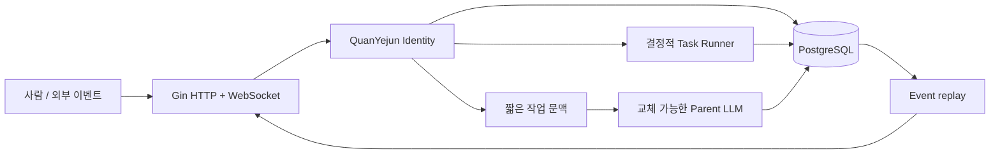

# MVP Architecture

## Identity가 루트다

웹소켓, HTTP 요청, LLM 호출, 작업 실행은 모두 수명이 짧습니다. `identity_quanyejun`과 PostgreSQL에 기록된 대화·기억·작업·이벤트가 연속성을 소유합니다.

프로젝트와 내부 Identity ID는 고정되지만 사용자에게 보이는 자기 이름은 `IDENTITY_DISPLAY_NAME`으로 분리합니다. Runtime이 정규화한 표기명을 bootstrap 응답과 LLM 문맥에 함께 전달하므로 이름을 바꿔도 저장된 Identity의 연속성은 유지됩니다.

## 대화 흐름

1. 런타임이 사용자의 메시지를 먼저 저장하고 `chat.message` 이벤트를 기록합니다.
2. 최근 메시지 10개와 관련 기억 5개를 조회합니다.
3. 영속 `AgentRun`을 만든 뒤 HTTP 요청에는 `202 Accepted`와 Run ID를 반환합니다.
4. Agent Runner가 현재 Parent LLM API에 짧은 문맥과 허용된 도구 정의를 전달합니다.
5. Tool Call은 실행 전후를 `run_steps`에 기록하고 결과를 다시 모델에 전달합니다.
6. 최종 응답 메시지와 이벤트를 저장한 다음 연결된 모든 클라이언트에 전달합니다.
7. 명시적 기억 요청은 `memory_remember` 도구를 통해 별도의 기억 레코드로 저장합니다.

## Provider 선택

`llm.Provider` 뒤에 OpenAI Responses API, Anthropic Messages API, 로컬 OpenAI 호환 HTTP API, 내장 미리보기 응답기를 둡니다. 운영에서는 Provider를 명시적으로 선택하고 API 자격 증명을 사용합니다. CLI 로그인이나 세션을 추론 계층에서 재사용하지 않습니다. 모델을 바꾸어도 Identity 데이터의 소유권은 Runtime에 남습니다.

## 작업 흐름

`POST /api/tasks/demo`는 작업을 먼저 저장하고 goroutine을 시작합니다. 이후 WebSocket이 끊겨도 작업은 런타임 프로세스 안에서 계속되며, 각 진행 단계가 DB 이벤트로 남습니다. 재연결한 클라이언트는 `lastEventId` 이후 이벤트를 재생합니다.

Agent Run은 시작 시 `queued`와 중단된 `running` 상태를 조회해 다시 실행합니다. 데모 Task Runner는 아직 프로세스 재시작까지 견디지 않으며, 외부 큐는 실제 처리량 요구가 확인된 뒤 추가합니다.

## 권한 경계

현재 MVP에는 하나의 알려진 actor가 있고 외부 부작용을 일으키는 skill이 없습니다. 다음 단계에서 skill을 추가할 때 capability 인터페이스와 authority 결정을 별도 계층으로 둡니다. LLM은 권한을 우회하거나 DB를 직접 수정하지 않습니다.
