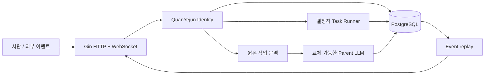

# MVP Architecture

## Identity가 루트다

웹소켓, HTTP 요청, LLM 호출, 작업 실행은 모두 수명이 짧습니다. `identity_quanyejun`과 PostgreSQL에 기록된 대화·기억·작업·이벤트가 연속성을 소유합니다.

## 대화 흐름

1. 런타임이 사용자의 메시지를 먼저 저장하고 `chat.message` 이벤트를 기록합니다.
2. 최근 메시지 10개와 관련 기억 5개를 조회합니다.
3. 현재 Parent LLM 제공자에게 짧은 문맥을 전달합니다.
4. 응답 메시지와 이벤트를 저장한 다음 연결된 모든 클라이언트에 전달합니다.
5. 사용자가 “기억해” 또는 “remember”라고 명시한 메시지는 원문 대화와 별도의 기억 레코드로 저장합니다.

## 작업 흐름

`POST /api/tasks/demo`는 작업을 먼저 저장하고 goroutine을 시작합니다. 이후 WebSocket이 끊겨도 작업은 런타임 프로세스 안에서 계속되며, 각 진행 단계가 DB 이벤트로 남습니다. 재연결한 클라이언트는 `lastEventId` 이후 이벤트를 재생합니다.

현재 작업 실행기는 프로세스 재시작까지 견디지는 않습니다. 영속 작업 재개와 외부 큐는 이 수직 조각에서 실제 필요성이 확인된 뒤 추가합니다.

## 권한 경계

현재 MVP에는 하나의 알려진 actor가 있고 외부 부작용을 일으키는 skill이 없습니다. 다음 단계에서 skill을 추가할 때 capability 인터페이스와 authority 결정을 별도 계층으로 둡니다. LLM은 권한을 우회하거나 DB를 직접 수정하지 않습니다.
